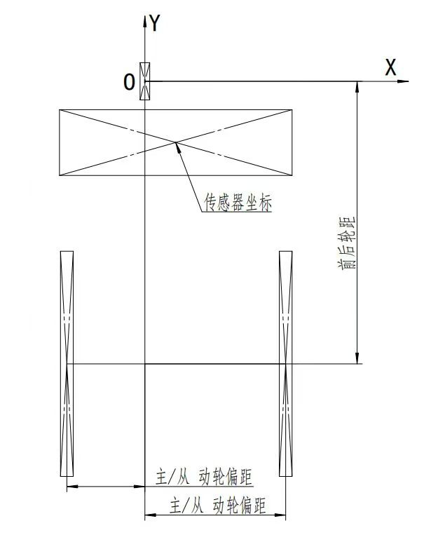

# 原版实操与对照记录

本文件用于记录原版实际操作和同输入输出对照。不能用本项目自身测试通过代替原版一致性验证。

## 已确认的坐标约定

用户于 2026-10-28 提供了下图。前轮转向轴为局部原点，X 向右、Y 向前；后轴处 Y 为负。主/从动轮偏距为各轮轴与车身 Y 轴的有符号 X 距离，两个后轮不必关于前轮对称。传感器坐标是其相对前轮轴的位置。

该图支持当前实现的坐标约定，但不证明凸轮旋向、零位、接触包络、曲线生成或评分算法一致。

## 对照方法

先比较确定性计算，再比较优化：

1. 原版固定参数与已知路线，关闭训练；记录版本、输入文件 SHA256、车辆参数、插值/曲线参数、实际传动比。
2. 导出前轮轨迹、传感器轨迹、理论凸轮和实际凸轮，分别保存原始文件；不要改变单位或擅自旋转/平移来对齐。
3. 首先验证相同前轮轨迹下的转向/传感器/主动轮行程，隔离路线生成算法差异。
4. 再比较理论凸轮的相位/半径、实际滚子包络；工作段和补全段分别判断。
5. 最后才比较相同目标点下的自动设计。优化有局部解、初始化和策略差异，不要求不加约束的两次训练逐点相同。

比较工具：`compare_reference_files`。它保留原坐标，报告长度差、首尾差、等归一化弧长配对误差和双向采样点到折线距离。闭合轮廓起始相位不同会体现在配对误差中；不能用形状距离较小掩盖装配相位错误。

目前的 `test_reference_comparison` 只验证比较工具本身，并不是原版结果验证。

## 原版实际操作（2026-10-28）

用户手动启动后，Computer Use 已成功取得并操作 MATLAB App 主窗口，窗口版本为 3.1.2。操作顺序：

1. 界面最初载入“25年工创浙江初赛”，类型为 5；修改“小车类型”至 4 后，帮助框明确显示“顶球型”，并列出全部五种类型。
2. 尝试用绝对路径导入：原版把路径分隔符等字符改成下划线，导致找不到文件。因此按软件实际规则，在 EXE 所在目录放入独立命名的 `codex_reference_20271028.mat` 副本，只输入不带扩展名的文件名。
3. 点击“导入”成功；帮助框显示“所有数据都加载完毕啦”。路线、转角、凸轮图出现，车体参数与 2027 文件一致：类型 4、轮径 130、传动比 20、c=25、r=2、d=100、主动轮 (79.5,-120)、从动轮 (-79.85,-120)、传感器 (0,-20)、方向 (0,1)。训练参数为 300 次、贝塞尔阶数 15、控制点 50、插值 11、平滑率 0.4、梯度力 64、学习率 0.3。
4. 修改导出类型为 1，读取完整导出清单；点击“导出”实测。软件提示需要密钥，未生成点集，目录仅存在数据副本。用户随后明确确认没有导出授权，暂时无法导出。

原版修改参数或导入会更新数据文件时间；因此对照必须使用独立副本。首次复制前的 2027 输入 SHA256 为 `1EED6456B1F9E7C115314A1F470E507203B16F8E44F24FA78702F980EC33ABCE`。原输入文件保留不变。

首次导出尝试前没有进行训练。用户确认无导出授权后，继续在独立副本上体验了短训练、正反向切换及动画，见后续记录；这些操作后的结果不能冒充最初输入的数值基线。

### 内置帮助确认的编号

| 机构编号 | 3.1.2 实际界面 | 早期手册 |
|---|---|---|
| 1 | 平推 | 平推 |
| 2 | 齿条 | 斜推 |
| 3 | 周转 | 顶球 |
| 4 | 顶球 | 齿条 |
| 5 | 斜推 | 未列出 |

2027 文件 version 为 `3.1.2`，car_type 为 4，属于顶球。此前 v0.1 将其按齿条导入的做法错误，现已修正。默认示例沿用点位另做齿条方案，不能作为原文件同输入对照。

顶球说明：凸轮推面与转向推动点均与前轮竖轴连接；推动点轨迹圆心在前轮竖轴上；c 为推动点至前轮竖轴距离；采用圆形包络。

| 导出类型 | 点集/数据 |
|---|---|
| 1 | 打卡点集 |
| 2 | 控制点集 |
| 3 | 前轮点集 |
| 4 | 车身点集 |
| 5 | 主动轮点集 |
| 6 | 从动轮点集 |
| 7 | 传感器点集 |
| 8 | 前轮转角数据 |
| 9 | 理论凸轮轮廓点集 |
| 10 | 实际凸轮轮廓点集 |

原版正常流程说明为：创建/导入 → AI 设计 → 导出 → 加工安装试跑 → 反推仿真辅助修正。修改参数并提交后，左下角帮助框显示其定义；更新有短暂延迟，不能立即把旧帮助当成新参数说明。

启动帮助自述“采用无监督强化学习”。这是作者的功能描述，当前没有源码或训练机制证据足以证实其具体强化学习架构，也不足以断言完全没有 AI。梯度/控制点存档等证据和该表述应分开记录。

## 对照状态

| 项目 | 状态 |
|---|---|
| 原版 3.1.2 EXE | 工作副本 SHA256 `A36C661E5FB5DDC6C740AA599152BFE8732853CDB9BFC0FBB128A400BE10CED3` |
| MATLAB R2022b | 本机注册表显示已安装于 `E:\Program Files` |
| 可运行性 | 用户确认可打开、可计算，启动较慢 |
| 导出可用性 | 已点击导出，原版提示需要密钥，未产生点集；用户确认没有导出授权 |
| 原版主窗口操作 | 已完成窗口读取、参数帮助、2027 副本导入和导出尝试；最初的窗口访问超时已解决 |
| 原版输出点集 | 尚未取得 |
| 数值是否一致 | 尚不能判断 |

仓库内工作副本在被 Git 忽略的 `local/reference_app/`；因原版文件名限制，另外在原 EXE 目录放了上述独立输入副本。收到合法导出后复制到 `local/reference_outputs/` 做比较。不将软件可执行文件、授权字段、硬件标识提交到仓库。

导出可用后，先给原版设置机制 2（齿条）或 1（平推），保持其他输入和控制点固定，再导出类型 3/5/7/8/9/10。同一前轮路线的运动学对照应先于不同路线生成器的最终轮廓对照。比较时还要确认原版是否会补全回程，以及凸轮坐标零位/旋向；不能自动拟合对齐后宣称等价。

## 用户确认后的工作范围

用户于 2026-10-28 再次确认：实际小车机构尚未确定，先复现平推和齿条；没有原版导出授权。当前继续通过正常界面了解可用功能、记录参数语义，并验证独立模型；逐点数值对照保持未完成状态。不把界面曲线相似或本项目自身测试通过写成原版一致性证据。

## 无导出授权下完成的功能体验

继续使用 `codex_reference_20271028.mat` 副本，原始 2027 输入文件未改动。

- 切换类型 1 后的帮助：平推，凸轮推面和转向推动点均在滑块上；c 为推动点运动直线至前轮竖轴的距离；圆形包络。
- 切换类型 2 后的帮助：齿条，凸轮推面和齿条均在滑块上；c 为转向齿轮分度圆半径；圆形包络。
- 修改 c 后的帮助：c 为非零实数，俯视车头朝上，正数表示凸轮在前轮右侧，负数表示在左侧。
- 修改 d 后的帮助：前轮与主动轮平行的基准态下，推面中轴与凸轮中轴距离的两倍，默认两中轴处于同一水平高度。它并非实际轮廓的最小直径。
- 点击“正向计算”后，按钮变成“反推仿真”，帮助显示仿真完成，并明确从理论凸轮结合参数重算路线；再次点击回到正向模式并加载数据。其参数试调语义促使本项目增加固定凸轮模式。
- 训练次数设为 2，帮助提醒少于 200 次通常不能触发平滑算法，所以此次仅体验流程，不评价收敛质量。
- 在齿条、c=25、d=100、轮径 130、传动比 20 下点击“AI设计”：显示启用 20 个线程；开始时插值数量由 11 调到 5，结束为 7。训练前副本保存在 `local/reference_app/rack_ui_before_train.mat`（SHA256 `4C319CE96E42DD4D299304B6677411203954286CF07A30C2AF10EFF0BAE0C388`）。
- 点击“动画”，实际看到车体沿路线移动、转角点和凸轮相位标记变化；点击“停止”后帮助确认已按下停止。没有验证“等待”按钮或长时间训练中断的全部边界。

原版训练后界面读数（未经导出，不构成逐点校验）：

| 指标 | 原版显示 |
|---|---:|
| 迭代次数 | 2 |
| 训练时长 | 4.2435（界面未标单位） |
| 梯度力 | 64 |
| 综合分数 | -49388268457.1026 |
| 主动轮路线长度 | 6704.3258 mm |
| 前轮最大左转角 | 30.7927° |
| 前轮最大右转角 | 14.4503° |
| 凸轮最大压力角 | 54.1422° |

帮助说明综合分数按 AI 权重扣分、必为负数、越接近零越好。这与本项目目前正值且越小越好的归一化目标不同，两个分数不能直接比较。上述原版使用保存的控制点及其曲线算法；本项目默认采用独立插值样条，不能把两条不同路线的压力角差异归咎于凸轮几何公式。
