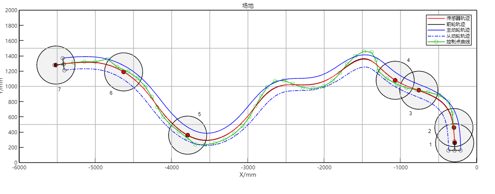
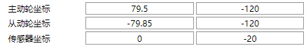
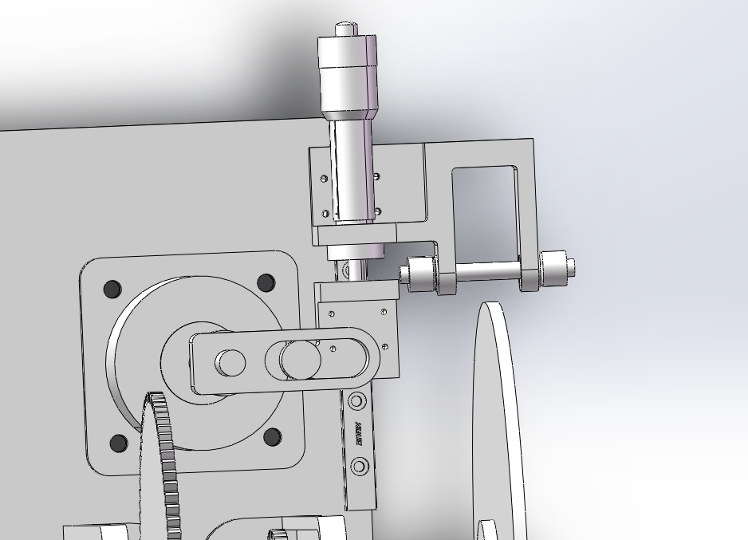
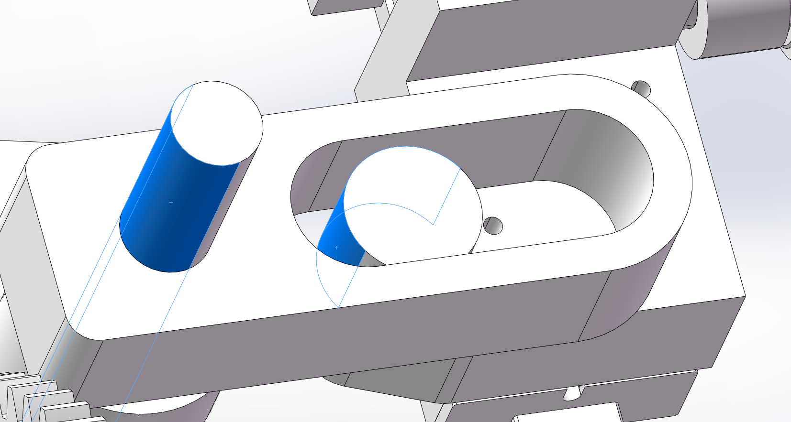

# 原版实操与对照记录

本文件用于记录原版实际操作和同输入输出对照。不能用本项目自身测试通过代替原版一致性验证。

## 根据已观察行为继续实现（2026-10-29）

本轮结合已做的原版体验、六段原理教程与更新日志，建立 [功能证据清单](FEATURE_STATUS.md)，区分可实现的交互、独立计算实现和未恢复的精确算法。更新日志原文件 SHA256 已再次核对，与既有提取记录一致。

只读恢复当前已打开的原版 3.1.2 窗口，确认黑色前轮、红色传感器、蓝实线主动轮、蓝虚线从动轮和绿色控制点曲线的图例；没有编辑其当前数据包。随后在复现版加入从动轮显示及地图节点编辑。原版点击抓取/放下行为为依据，本版增加明确确认/取消、非法候选保护、表格同步和未保存提示，预览期间保留旧轨迹且明确标注。

本版节点仍是独立三次样条插值节点，并非原版贝塞尔控制点。11 项回调/状态检查及既有界面回归通过，真实鼠标验收尚未完成；详情见 [验证记录](VALIDATION.md#场地图路线节点编辑2026-10-29)。本轮没有把相同颜色图例或本版回归通过记为原版轨迹/凸轮一致。

## 队伍赛项澄清与太阳能点位（2026-10-29）

用户明确队伍参加**太阳能电动车**，已有生物质能点位可以用于测试。此前按资料文件名关联到生物质能，不应继续据此把队伍归类到该赛项。机构仍按用户确认的平推型；两个赛项可复用机构运动学计算，但正式目标和验收条件要分别配置。

用户提供的同一份 20 页规则 PDF 前半部分就是太阳能赛项。已读取并渲染核对第 5、6、8 页。第 6 页表 2 有 16 行，首尾地球坐标相同，为 15 处不同位置；初赛指定 **10 次顺序访问、9 处不同位置**：

| 初赛访问顺序 | 表 2 序号 | 地点 | X / mm | Y / mm |
|---|---|---|---:|---:|
| 1 | 1 | 地球（起点） | 410 | 420 |
| 2 | 3 | 金星 | 700 | 1580 |
| 3 | 4 | 太阳 | 1440 | 1100 |
| 4 | 6 | 谷神星 | 3170 | 1560 |
| 5 | 8 | 天王星 | 4160 | 1440 |
| 6 | 10 | 冥王星 | 5110 | 1630 |
| 7 | 12 | 鸟神星 | 5450 | 440 |
| 8 | 14 | 木星 | 3250 | 350 |
| 9 | 15 | 水星 | 2500 | 750 |
| 10 | 16 | 地球（终点） | 410 | 420 |

太阳能点库 `data/2027_solar_course.json` 保留原表正 X 坐标，场地范围 `[0,6000]×[0,2000] mm`，不照搬生物质能旧软件的 X 取负约定。`camdesign.course2027Solar()` 提供点表与初赛顺序，`check_2027_solar_course` 生成 CSV 和顺序图。最后的地球记录必须保留；规则明确除地球外其他标志点顺序标记且一次，不能将合法终点当成重复点错误，也不能在开局就算已经到达终点。

第 8 页只要求发车前在地球正后方的场地内等待，没有给出固定发车坐标。因此不得把生物质能旧辅助点 `(-290,260)` 用作太阳能发车点。目标回到同一位置，不自动意味着车身姿态、前轮转角和凸轮相位也必须与出发时相同；车辆闭合行程和凸轮完整轮廓的周期补全是不同约束，需要在后续设计中分别确认。

第 5～6 页同样说明 6000×2000 mm 场地、红圈直径 40 mm、UID 标签直径 17～30 mm、坐标以现场为准；识别容差仍需实测。决赛点位和情景点现场公布，不能从初赛点表推定完整决赛路线。

本次已接入太阳能数据并检查顺序，未改界面历史默认样例，也未生成太阳能实车制造用凸轮。之后队伍实际设计应以太阳能点库为准，生物质能 7/12/13 点仅作为明确标注的试验案例。

## 2027 生物质能点位核对（仅作测试，2026-10-29）

来源为用户提供的《01-2027年第十届 工程实践赛道命题与运行.pdf》，共 20 页，SHA256 `390bde4a2c6d47601fa92bb47cafbe24b309820314d74da09bcaaf40f2a7c42b`。本次读取全文文本，并渲染、逐页核对生物质能相关的第 14～17 页；此处说明仅针对这份文件，不声称已查证后续补充通知。前半部分太阳能点表与本项目现有生物质能点位不同，不能混用。

第 15～16 页表 4 给出 **31 个备选地点**；第 16 页指定初赛按 **12 个标志点**依次标记且一次：

| 初赛顺序 | 表 4 序号 | 地点 | 原表 X / mm | Y / mm | 已有软件 X / mm |
|---|---|---|---:|---:|---:|
| 1 | 1 | 西安 | 300 | 460 | -300 |
| 2 | 4 | 张掖 | 760 | 950 | -760 |
| 3 | 6 | 敦煌 | 1070 | 1080 | -1070 |
| 4 | 9 | 吐鲁番 | 1370 | 1396 | -1370 |
| 5 | 11 | 库车 | 1710 | 1260 | -1710 |
| 6 | 13 | 喀什 | 2080 | 1010 | -2080 |
| 7 | 16 | 撒马尔罕 | 2570 | 1030 | -2570 |
| 8 | 18 | 马雷 | 2850 | 810 | -2850 |
| 9 | 21 | 伊斯法罕 | 3400 | 300 | -3400 |
| 10 | 23 | 巴格达 | 3790 | 360 | -3790 |
| 11 | 26 | 伊斯坦布尔 | 4630 | 1190 | -4630 |
| 12 | 31 | 罗马 | 5517 | 1280 | -5517 |

读取用户原 `2027生物质能初赛_直播.mat` 的 pathway_points，后 12 行与上表在 `X软件=-X原表，Y软件=Y原表` 下逐项完全相同。最前一行 `(-290,260)` 不在官方标志点表内，现记录为旧数据辅助点；从其位置推测用于发车引导，但 PDF 没有指定这个坐标，第 17 页只要求在西安正后方的场地内待发。它不是第 13 个计分标志点，不能把“数据里有 13 行”写成“比赛要求 13 个标志点”。该映射只针对场地坐标，不改变车辆局部左右轴、转向机构符号或凸轮旋向。

用户此前的七点截图包含辅助点、西安、张掖、敦煌、巴格达、伊斯坦布尔、罗马，仅覆盖初赛 12 点中的 6 点。缺少吐鲁番、库车、喀什、撒马尔罕、马雷、伊斯法罕，因此仍可作软件体验/取点样例，但不能用作今年完整初赛路线的验收案例。

对生物质能测试案例的直接影响（不代表队伍正式赛项）：

- 正式初赛的打卡目标为上述 12 点；发车位置与引导节点应独立于计分目标。当前 `defaultProject` 保留原有 13 行齿条回归样例，评分仍按其传入目标计算，不将其报告冒充今年比赛成绩；本次没有静默删点或更换已验证的历史样例。
- `data/2027_biomass_course.json` 保存 31 点、初赛顺序、双坐标列、PDF 来源和辅助点性质；`camdesign.course2027Biomass()` 提供明确的 `preliminaryOfficialMM` 与 `preliminarySoftwareMM`。`check_2027_course` 核对数据后输出 31 点及 12 点 CSV、点位顺序图。
- 第 14 页场地为 6000×2000 mm；第 16 页注明喷绘布有弹性，坐标以现场为准。后续应允许现场坐标修正，而不是把参考坐标锁死。
- 第 14 页红色圆外径 40 mm、UID 标签直径 17～30 mm；这些不是已标定的读卡器中心允许偏差。当前 `hitTolerance=30 mm` 只是历史优化参数，不是赛题认可的误差范围。不能据“中心距小于 30 mm”宣称标记成功。
- 决赛点位及数量将与初赛不同，含现场发布的情景点。31 点是备选点库，不是已知决赛顺序。
- 规则要求按顺序且每个标志点只经过一次。现有 `orderedHits` 只给出几何配对偏差，并未实现重复读卡/错误顺序触发、整车越界、实际识别范围或时间评分的完整判定。

本次只是点位与来源核对，没有进行原版/复现版同路线输出一致性验收，也没有补齐队伍实车尺寸或改变原版当前参数。

## 已确认的坐标约定

用户于 2026-10-28 提供了下图。前轮转向轴为局部原点，X 向右、Y 向前；后轴处 Y 为负。主/从动轮偏距为各轮轴与车身 Y 轴的有符号 X 距离，两个后轮不必关于前轮对称。传感器坐标是其相对前轮轴的位置。


该图支持当前实现的坐标约定，但不证明凸轮旋向、零位、接触包络、曲线生成或评分算法一致。

### 三张图的对应关系（2026-10-29）

用户补充的场地图、车体坐标图和参数截图形成同一条几何关系链：局部坐标定义 → 车体固定尺寸 → 随运动生成各点在场地中的轨迹。

**来源澄清：用户随后明确软件中的参数是作者默认值。** 本节数值仅用于解释默认示例的坐标关系和数学检查，不是队伍实车尺寸。此前对话中称其为“实际尺寸”的说法已撤回；轴距 120、后轮间距 159.35、传感器后移 20 mm 均不得直接用于队伍实车设计。





本次提供的[车体坐标原图](assets/vehicle_coordinate_reference.png)也随记录保存。

| 部位 | 相对前轮转向轴的局部坐标 / mm | 含义 |
|---|---|---|
| 前轮转向轴 | (0,0) | 车体坐标原点 |
| 主动后轮 | (79.5,-120) | 车身右侧 79.5 mm，后方 120 mm |
| 从动后轮 | (-79.85,-120) | 车身左侧 79.85 mm，后方 120 mm |
| 传感器参考点 | (0,-20) | 车身中心线上，前轮轴后方 20 mm |

因此轴距为 120 mm，后轮横向间距为 159.35 mm；后轴中点局部 X=-0.175 mm，并非严格位于车体 Y 轴。不能把两个后轮强制设成左右各 80 mm。

第一张图图例：红实线=传感器轨迹，黑实线=前轮轨迹，蓝实线=主动轮轨迹，蓝虚线=从动轮轨迹，绿圈连线=控制点曲线。黑圆及编号对应打卡点显示；图中圆的半径不能未经赛题/参数确认就作为传感器允许误差或障碍物半径。绿色控制点不必落在前轮曲线上，它们参与生成路线，不是独立运动部件。

设场地中的前轮轴位置为 F，车身向前单位向量为 f，向右单位向量为 r，则任意局部点 (x,y) 的场地位置为 `F+x*r+y*f`。若车身航向角 ψ 从场地 X 正轴逆时针计量，则 `f=(cosψ,sinψ)`、`r=(sinψ,-cosψ)`。本例：

- 传感器 `S=F-20*f`；主动轮 `D=F+79.5*r-120*f`；从动轮 `P=F-79.85*r-120*f`。
- 发车朝 +Y 时，S=F+(0,-20)；车头转到朝 -X 时，S=F+(20,0)。偏移随车身旋转，不能始终在场地 Y 轴减 20。
- ψ 是车身航向，不是转向前轮的滚动方向。前轮切线方向与 ψ 相差转向角 δ，需由后轮无侧滑约束计算车身姿态。
- 同时刻 F 与 S 始终相距 20 mm，但两条完整轨迹之间的最近距离不必等于 20 mm。必须区分同相位配对和曲线最近距离。
- 打卡检查应基于传感器轨迹；凸轮相位应基于主动轮累计行程。在转弯中前轮、主动轮、从动轮的行程一般不同。

原版本次“创建”后的第一个控制点显示 (-290,280)，首个打卡点为 (-290,260)，发车方向 (0,1)、传感器 (0,-20)，与上述起点补偿关系吻合。该单点证据不等于整条路线数值对照通过。原图有 7 个目标，而仓库默认方案有 13 个，不能将两者最终凸轮直接比较。

复现版 `route.m` 与 `simulate.m` 已使用车身航向转换坐标；`run_tests` 的解析圆弧检查现覆盖上述三条偏置轨迹（最大允许误差 0.05 mm）、固定传感器距离和不对称后轮间距。2026-10-29 在 R2025b 实跑 12/12 项通过。

## 对照方法

先比较确定性计算，再比较优化：

1. 原版固定参数与已知路线，关闭训练；记录版本、输入文件 SHA256、车辆参数、插值/曲线参数、实际传动比。
2. 导出前轮轨迹、传感器轨迹、理论凸轮和实际凸轮，分别保存原始文件；不要改变单位或擅自旋转/平移来对齐。
3. 首先验证相同前轮轨迹下的转向/传感器/主动轮行程，隔离路线生成算法差异。
4. 再比较理论凸轮的相位/半径、实际滚子包络；工作段和补全段分别判断。
5. 最后才比较相同目标点下的自动设计。优化有局部解、初始化和策略差异，不要求不加约束的两次训练逐点相同。

比较工具：`compare_reference_files`。它保留原坐标，报告长度差、首尾差、等归一化弧长配对误差和双向采样点到折线距离。闭合轮廓起始相位不同会体现在配对误差中；不能用形状距离较小掩盖装配相位错误。

目前的 `test_reference_comparison` 只验证比较工具本身，并不是原版结果验证。

### 无导出点集时的图片与可见数值对照（2026-10-29）

“精确算法尚未确认”指原版的具体实现尚未查明，如贝塞尔分段/拼接、采样和平滑、评分表达式、搜索更新及凸轮闭合段；不意味着只有原版能算准，也不意味着必须得到其源码才能实现正确的运动学。需要区分数学模型正确、与原版结果一致、实车能准确打卡三件事。

用户提出先用图片或特征点比较，该方法可作为阶段验收：

1. 优先记录原版直接显示的数值：主动轮行程、最大左右转角、最大压力角，以及点表中实际可见的坐标；按显示小数位判断，不能虚构更多有效位。
2. 固定相同输入和状态，不训练，确认原版已完成重算。用坐标轴刻度将截图像素映射至毫米；原图分辨率、坐标范围和图例遮挡区域一并保存。禁止为了叠合而自由缩放、旋转或平移候选结果。
3. 比较前轮/传感器路径、转角随主动轮行程、理论凸轮和实际凸轮。分开报告工作段与补全段、位置与相位。曲线图上的同色标记、遮挡和抗锯齿需要计入读图误差。
4. 对凸轮可比较明确角度下的半径、最大/最小半径及对应角度、极值和接缝。角度零位与旋向应先核定；只对几个点不能排除点间尖峰、回程不连续或局部干涉。
5. 同目标点的自动优化不保证产生相同路线。先固定路线隔离运动学，再分别对照优化结果；不把控制点与前轮轨迹点混用。

已实现 `digitize_reference_image`：仅读取 RGB 截图，接受显式轴刻度、绘图区、遮挡排除框与颜色，输出毫米坐标的**无序可见像素点云**、原像素位置、标定记录和独立散点预览。没有自动拟合或修改原图，没有将无序点连接为曲线。当前颜色阈值会同时包含同色点标记，不能将结果冒充原版原始点集；也不能直接把无序 CSV 传给要求有序折线的 `compare_reference_files`。

运行 `measure_supplied_reference_image`，从用户提供的七点场地图（1142×448）提取到 1,441 个红色曲线/标记像素。人工轴标定为 x 像素 44→-6000 mm、1100→0 mm；y 像素 24→2000 mm、375→0 mm。图例区域已排除。尺度为 X=5.6818、Y=5.6980 mm/像素；若暂取 ±2 像素定位余量，对应单轴约 ±11.4 mm。这是明示的读图假设，不是经过统计标定的置信区间，遮挡与标记可能使局部误差更大。已检查生成的散点预览，主要红色路线保留，首尾及交叠处有缺段。该图片尚未和一个输入完全核对的复现运行配对，因此**此项只证明取点方法可行，不证明两程序一致**。

可复现入口：

```matlab
measure_supplied_reference_image;
prepare_visual_reference_case;
```

`prepare_visual_reference_case` 生成独立的平推直线基准：D=130、i=20、c=25、r=2、d=100、f=5，前轮沿 x=-300、y=280…2280 行驶，传感器 y=-20；均为作者默认尺寸，不是队伍实测值。复现版与解析结果：主动轮 2000 mm、转角/压力角 0°、理论半径 50 mm、实际半径 48 mm。MATLAB R2025b 已实跑通过这些断言。原版输入保留必需的 `key=0` 未授权字段，未提供或绕过导出授权。

本次原版导入直线试验没有得到完成状态：场地及转角图被清空，凸轮仍残留旧图；补齐 MAT 字段、尝试新名称创建以及重新导入既有七点试验后，仍未确认正常完成。因此没有采纳残留凸轮图进行测量，也不将这个现象直接定性为原版不支持直线。已关闭本次试验窗口并请求重启，尚待确认新主窗口。两个用户来源文件 SHA256 与既有记录一致。生成的直线输入、报告和图片均留在 Git 忽略目录，源码与方法记录纳入版本控制。

## 原版实际操作（2026-10-28）

用户手动启动后，Computer Use 已成功取得并操作 MATLAB App 主窗口，窗口版本为 3.1.2。操作顺序：

1. 界面最初载入“25年工创浙江初赛”，类型为 5；修改“小车类型”至 4 后，帮助框明确显示“顶球型”，并列出全部五种类型。
2. 尝试用绝对路径导入：原版把路径分隔符等字符改成下划线，导致找不到文件。因此按软件实际规则，在 EXE 所在目录放入独立命名的 `codex_reference_20271028.mat` 副本，只输入不带扩展名的文件名。
3. 点击“导入”成功；帮助框显示“所有数据都加载完毕啦”。路线、转角、凸轮图出现，车体参数与 2027 文件一致：类型 4、轮径 130、传动比 20、c=25、r=2、d=100、主动轮 (79.5,-120)、从动轮 (-79.85,-120)、传感器 (0,-20)、方向 (0,1)。训练参数为 300 次、贝塞尔阶数 15、控制点 50、插值 11、平滑率 0.4、梯度力 64、学习率 0.3。
4. 修改导出类型为 1，读取完整导出清单；点击“导出”实测。软件提示需要密钥，未生成点集，目录仅存在数据副本。用户随后明确确认没有导出授权，暂时无法导出。

原版修改参数或导入会更新数据文件时间；因此对照必须使用独立副本。首次复制前的 2027 输入 SHA256 为 `1EED6456B1F9E7C115314A1F470E507203B16F8E44F24FA78702F980EC33ABCE`。原输入文件保留不变。

首次导出尝试前没有进行训练。用户确认无导出授权后，继续在独立副本上体验了短训练、正反向切换及动画，见后续记录；这些操作后的结果不能冒充最初输入的数值基线。

### 内置帮助确认的编号

| 机构编号 | 3.1.2 实际界面 | 早期手册 |
|---|---|---|
| 1 | 平推 | 平推 |
| 2 | 齿条 | 斜推 |
| 3 | 周转 | 顶球 |
| 4 | 顶球 | 齿条 |
| 5 | 斜推 | 未列出 |

2027 文件 version 为 `3.1.2`，car_type 为 4，属于顶球。此前 v0.1 将其按齿条导入的做法错误，现已修正。默认示例沿用点位另做齿条方案，不能作为原文件同输入对照。

顶球说明：凸轮推面与转向推动点均与前轮竖轴连接；推动点轨迹圆心在前轮竖轴上；c 为推动点至前轮竖轴距离；采用圆形包络。

| 导出类型 | 点集/数据 |
|---|---|
| 1 | 打卡点集 |
| 2 | 控制点集 |
| 3 | 前轮点集 |
| 4 | 车身点集 |
| 5 | 主动轮点集 |
| 6 | 从动轮点集 |
| 7 | 传感器点集 |
| 8 | 前轮转角数据 |
| 9 | 理论凸轮轮廓点集 |
| 10 | 实际凸轮轮廓点集 |

原版正常流程说明为：创建/导入 → AI 设计 → 导出 → 加工安装试跑 → 反推仿真辅助修正。修改参数并提交后，左下角帮助框显示其定义；更新有短暂延迟，不能立即把旧帮助当成新参数说明。

启动帮助自述“采用无监督强化学习”。这是作者的功能描述，当前没有源码或训练机制证据足以证实其具体强化学习架构，也不足以断言完全没有 AI。梯度/控制点存档等证据和该表述应分开记录。

## 对照状态

| 项目 | 状态 |
|---|---|
| 原版 3.1.2 EXE | 工作副本 SHA256 `A36C661E5FB5DDC6C740AA599152BFE8732853CDB9BFC0FBB128A400BE10CED3` |
| MATLAB R2022b | 本机注册表显示已安装于 `E:\Program Files` |
| 可运行性 | 用户确认可打开、可计算，启动较慢 |
| 导出可用性 | 已点击导出，原版提示需要密钥，未产生点集；用户确认没有导出授权 |
| 原版主窗口操作 | 已完成窗口读取、参数帮助、2027 副本导入和导出尝试；最初的窗口访问超时已解决 |
| 原版输出点集 | 尚未取得 |
| 数值是否一致 | 尚不能判断 |

仓库内工作副本在被 Git 忽略的 `local/reference_app/`；因原版文件名限制，另外在原 EXE 目录放了上述独立输入副本。收到合法导出后复制到 `local/reference_outputs/` 做比较。不将软件可执行文件、授权字段、硬件标识提交到仓库。

导出可用后，先给原版设置机制 2（齿条）或 1（平推），保持其他输入和控制点固定，再导出类型 3/5/7/8/9/10。同一前轮路线的运动学对照应先于不同路线生成器的最终轮廓对照。比较时还要确认原版是否会补全回程，以及凸轮坐标零位/旋向；不能自动拟合对齐后宣称等价。

## 用户确认后的工作范围

用户于 2026-10-28 再次确认：实际小车机构尚未确定，先复现平推和齿条；没有原版导出授权。当前继续通过正常界面了解可用功能、记录参数语义，并验证独立模型；逐点数值对照保持未完成状态。不把界面曲线相似或本项目自身测试通过写成原版一致性证据。

## 无导出授权下完成的功能体验

继续使用 `codex_reference_20271028.mat` 副本，原始 2027 输入文件未改动。

- 切换类型 1 后的帮助：平推，凸轮推面和转向推动点均在滑块上；c 为推动点运动直线至前轮竖轴的距离；圆形包络。
- 切换类型 2 后的帮助：齿条，凸轮推面和齿条均在滑块上；c 为转向齿轮分度圆半径；圆形包络。
- 修改 c 后的帮助：c 为非零实数，俯视车头朝上，正数表示凸轮在前轮右侧，负数表示在左侧。
- 修改 d 后的帮助：前轮与主动轮平行的基准态下，推面中轴与凸轮中轴距离的两倍，默认两中轴处于同一水平高度。它并非实际轮廓的最小直径。
- 点击“正向计算”后，按钮变成“反推仿真”，帮助显示仿真完成，并明确从理论凸轮结合参数重算路线；再次点击回到正向模式并加载数据。其参数试调语义促使本项目增加固定凸轮模式。
- 训练次数设为 2，帮助提醒少于 200 次通常不能触发平滑算法，所以此次仅体验流程，不评价收敛质量。
- 在齿条、c=25、d=100、轮径 130、传动比 20 下点击“AI设计”：显示启用 20 个线程；开始时插值数量由 11 调到 5，结束为 7。训练前副本保存在 `local/reference_app/rack_ui_before_train.mat`（SHA256 `4C319CE96E42DD4D299304B6677411203954286CF07A30C2AF10EFF0BAE0C388`）。
- 点击“动画”，实际看到车体沿路线移动、转角点和凸轮相位标记变化；点击“停止”后帮助确认已按下停止。没有验证“等待”按钮或长时间训练中断的全部边界。

原版训练后界面读数（未经导出，不构成逐点校验）：

| 指标 | 原版显示 |
|---|---:|
| 迭代次数 | 2 |
| 训练时长 | 4.2435（界面未标单位） |
| 梯度力 | 64 |
| 综合分数 | -49388268457.1026 |
| 主动轮路线长度 | 6704.3258 mm |
| 前轮最大左转角 | 30.7927° |
| 前轮最大右转角 | 14.4503° |
| 凸轮最大压力角 | 54.1422° |

帮助说明综合分数按 AI 权重扣分、必为负数、越接近零越好。这与本项目目前正值且越小越好的归一化目标不同，两个分数不能直接比较。上述原版使用保存的控制点及其曲线算法；本项目默认采用独立插值样条，不能把两条不同路线的压力角差异归咎于凸轮几何公式。

## 第二轮功能体验（2026-10-29）

### 数据隔离

启动时原版已打开 `codex_reference_20271028`，本次所见为 7 个打卡点，不再是首次导入的 13 点。操作前复制到本地忽略目录 `local/reference_app/seven_target_before_feature_audit_20261029.mat`，SHA256 为 `D351E4DB8A795975F75DB0826DF97BAE0DC3F2F06A5284F214CD44804C52BB15`。随后在原版输入未存在的文件名 `codex_feature_audit_20261029` 并点击“创建”。全部变更仅在这个独立试验数据包内进行。

### 实际行为

| 功能 | 本次操作与证据 | 对复现的意义 |
|---|---|---|
| 文件名 | 输入新名称、Tab 提交，帮助提示数据包不存在；未自动创建文件 | 区分改名、创建、导入 |
| 创建 | 新 MAT 实际产生，初始路线和凸轮重新生成；保留原有 7 个目标及车体参数 | 创建不是“另存当前路线”；会初始化控制点 |
| 点集切换 | 表头在“必过点”和“控制点”之间切换 | 目标点与路线控制点是两套数据 |
| 添加行 | 控制点模式、行号 5，新增 (-425.2269,678.5547)，为原第 4、5 点平均值，原第 5 点后移 | 插入行为有几何初始化规则 |
| 删除行 | 删除刚新增的试验行，第 5 点恢复 (-467.0768,728.3352)，图恢复 | 插入/删除对独立试验数据可逆 |
| 表格编辑 | 第 5 个目标 Y 从 360 改为 370，提交后新读数确认 370 | 帮助提示修改目标后建议重新创建，不能忽略现有控制点的初始化问题 |
| AI 设计 | 300 次上限，实际开始训练，插值先降到 5，出现 AI 搜索方向及权重火焰图 | 训练过程包含自动精度与参数调节 |
| 等待 | 训练中按下，按钮变黄；提示在下一次局部最优退出，实际第 20 次退出 | 是条件终止，不是暂停/恢复 |
| 停止 | 再次训练中按下，第 15 次退出；明确显示“强行打断成功” | 已验证训练中的中断，不只是空闲时按钮响应 |
| 控制曲线移动 | 最初按住绿圈拖动未成功；经用户说明后，已验证空白处点击抓取、移动、再次点击放下，详见下节 | 已覆盖正常点选移动；短距离确认不稳定 |
| 周转型（3） | 修改类型并提交：推面在滑块上，推动点与前轮竖轴连接；c 是推动点至前轮竖轴距离，圆形包络 | 不能按齿条模型静默解释 |
| 斜推型（5） | 修改类型并提交：推面与推动面是同一圆弧面，其轴心与前轮竖轴垂直相交；c 是凸轮中间平面到前轮竖轴的距离，椭圆包络 | 与当前移动滚子圆形包络的实现假设不同 |
| AI 权重 | 打卡偏移权重从 10 改成 9；帮助明确取整数 1～10，并描述距离和、越大侧重越多、建议为所有指数最大值 | 这是相对权重含义证据，不能直接认定系数等于输入整数或 10 的该次幂 |
| 数据格式 | 设置 xls 并提交，读取完整格式帮助：scr_line、scr_spline、scr_arc、ibl、dat、txt_sw、txt_high、xls | 确认格式选择及语义；因无导出授权，尚未生成或验证这些文件 |

“创建”后读数为总点数 760、主动轮路线长 6336.5581 mm、最大左转 15.5595°、最大右转 12.8968°、最大压力角 73.9581°。这是独立 7 点试验的初始状态，不能与旧 13 点案例混用。

第一次“等待”退出时：第 20 次，训练时长 12.3017（界面未标单位），梯度力 4，综合分数 -100144816.1974，主动轮长 6369.7019 mm，左转 14.2147°，右转 10.5164°，压力角 30.9919°。训练中观察到梯度力 16→8、平滑率 0.2048、插值 11；结束后设置框回到梯度力 64、平滑率 0.4、插值 12。可见动态内部量与结束后的设置值应分别记录。

第二次“停止”退出时：第 15 次，训练时长 7.1782，梯度力 8，综合分数 -132884993.5707，主动轮长 6411.0559 mm，左转 14.4051°，右转 8.1659°，压力角 35.4658°。两次起始状态/训练过程不相同，不能据此推断随机性或最优解保存规则。

### 视频目录提供的算法线索

来源：用户提供的《工训赛学习视频目录(野生机设小佬编写_持续更新_2024年10月9日).xlsx》，Sheet1 共 87 行、7 列，SHA256 `73d0ca170eae4ee21823eef5306d5120062aca3d267a25c84064e0e5b268d04c`。文件名虽然写 2024-10-09，F1 内文写编写时间 2025-03-01。原表未修改。

| 单元格区域 | 原作者目录所述内容 | 阅读入口 |
|---|---|---|
| C19:F19 | 自制路线导入，与 AI 路线对比 | [路线导入](https://www.bilibili.com/video/BV1C4421U7qE) |
| C20:E20 | 路线、转角、推程、凸轮正逆计算 | [问答式讲解](https://www.bilibili.com/video/BV1614y1d7wz) |
| C22:F22 | 明确写“本软件的强化学习框架讲解” | [AI 原理](https://www.bilibili.com/video/BV18M41187tx) |
| C23:E23 | 高阶贝塞尔路线编程带写 | [路线编程](https://www.bilibili.com/video/BV1obN9enEtd) |
| C26:E26 | 凸轮包络原理及编程教学 | [凸轮包络](https://www.bilibili.com/video/BV1w84y1w7nF) |
| C27:F27 | 路线长度、轮径、传动比计算 | [传动比计算](https://www.bilibili.com/video/BV1ww4m1Y7zY) |
| C47:F47 | 从公式原理分析转向结构 | [转向机构](https://www.bilibili.com/video/BV1Rh411A7jK) |
| C72:E73 | 结合 SW 仿真和真实小车讲反推 | [反推01](https://www.bilibili.com/video/BV1is4y1a7zN)、[反推02](https://www.bilibili.com/video/BV1z54y1T7xC) |

这是作者目录中的描述。早先网页及浏览器访问失败，未取得视频正文；2026-10-29 后续已读取三个页面的元数据，并取得 AI 原理视频，核对了其关键画面，详见本文末尾“视频关键画面核对”。仍未取得人工字幕或完成语音转写，不能将关键帧阅读写成全片口述内容已核验。

当前仍未完成：控制点移动的交互边界、全部参数边界、每个导入/导出格式、动画中断边界、自动传动比触发条件、反推全部参数的定量原版对照。导出受已有授权限制；不能将正常功能体验写成“全部功能复现完成”。

本轮收尾时原版停留在独立的 `codex_feature_audit_20261029`，齿条型，测试打卡点 Y=370、打卡权重=9、格式=xls；这些试验设置不是推荐设计参数。原用户七点数据包和最初 2027 十三点文件的 SHA256 均再次核对未变。测试数据包另存到本地忽略目录供下轮复查。

### 用户提示后的控制点移动复测（2026-10-29）

用户说明在旁边白色处点击可以操作，并观察到似乎需要移动一定距离才能确认。随后读取原版帮助，明确步骤为：单击绿色控制点附近空白处，抓取鼠标附近最近的控制点；再次左键单击空白处，放开控制点。帮助还说明点击“导入”可撤回移动结果。因此普通的按住标记拖动不能作为此功能的正确验收步骤。

在独立测试包、最大化窗口（截图 2560×1392）实测：

1. 在场地图空白处单击 (1045,777)，帮助显示“正抓取第 26 个控制点”，绿色控制点移动到鼠标位置，路线和凸轮同时重算。
2. 移到 (1049,780) 再单击，屏幕距离约 5 像素；刷新后仍显示“正抓取”，未放下。
3. 移到 (1150,730) 再单击，屏幕距离约 113 像素；帮助变成“已松开第 26 个控制点”，内部更新时间改变，路线/转角/凸轮图均更新。
4. 放下后滚动左侧表，第 26 行仍显示旧值约 (-2924.9,399.7681)。点击“切换点集”两次，再查看第 26 行，才显示移动后的值约 (-2519.9,1403.4)。点表未立即同步，不能据旧表判断移动无效。
5. 移动完成后，磁盘试验 MAT 的 SHA256 仍与上一轮备份相同：`1944E2AB8A235D33D903DC4F8D7246B5F66F7EA335624E8916F48D9A10DFE0F2`，文件时间仍为 10:49:31，而界面内部更新时间已为 10:59:39。该操作更新当前界面状态，不等于立即写入 MAT；此结论仅限本次移动操作，不能推广到所有参数回调。
6. 点击“导入”，确认成功重载该测试包，尖峰控制点和相应转角/凸轮变化撤回，第 26 行恢复约 (-2924.9,399.7681)。收尾停留在已重载的测试包，格式恢复为 txt_sw、插值数量恢复为 11。

该试验支持用户所述的短距离点击难以确认现象，但不足以证明存在固定距离阈值。图形对象接收点击、鼠标移动回调及重绘时序均只是待验证解释，尚未定位根因。复现界面应明确显示选中/移动状态、及时同步点表、区分未保存修改与文件保存，并提供明确的确认/取消行为；这些是实现要求，当前不宣称已经实现鼠标交互。

### 六个机械参数逐项核对（2026-10-29）

用户进一步指出“小车类型”下方两行是关键参数。截图为类型 2、D=130、i=20、c=25、r=2、d=100、f=5。为调出各项帮助，在独立测试包将六个值临时改为 131、21、26、3、101、6，逐项提交并读取延迟更新后的说明；未训练。截图含与算法无关的机器标识，因此仅记录这些机械参数，不将完整截图纳入 Git。

| 参数 | 原版内置帮助确认的定义 | 与当前复现的对应 |
|---|---|---|
| 主动轮直径 D | 正数 | 主动轮行程至轮转角的换算 |
| 总传动比 i | 正数；凸轮转一圈时主动轮转动的圈数，特指主动轮至凸轮传动 | 已采用相同轮/凸轮约定；动力源至主动轮的传动不属于此字段 |
| 转向偏距 c | 非零实数；类型 2 时为转向齿轮分度圆半径；正/负表示凸轮在前轮右/左侧 | 已区分齿条和平推的位移律，界面改用“转向偏距 c” |
| 推杆半径 r | 正数；与凸轮接触的曲面半径，接触件可为钢轴、光轴、轴承等圆柱面 | 原“滚子半径”标签过窄，改为“推杆接触半径 r”；内部字段及圆包络算法保持不变 |
| 基圆直径 d | 正数；前轮与主动轮平行时，推面中轴与凸轮中轴间距离的两倍，默认同一水平高度 | 已按 d/2 作为零转角中心距；不等于实际轮廓最小直径 |
| 凸轮厚度 f | 正数；原版明确仅在斜推型时参与计算 | 当前平推/齿条方案仅保留厚度值；界面标明“仅记录”，不冒充已实现斜推厚度修正 |

r 的帮助还把加工偏差补偿放在此参数中说明：针对激光切割或热熔打印，调整名义接触半径来补偿工艺偏差。这是原作者给出的用法，具体偏差量未标定，当前复现没有自动加减此值，也不把这些描述当成通用加工保证。

本次参数修改会写入试验 MAT（11:08:46 的文件哈希与操作前备份不同），与上一节鼠标移动未立即落盘的行为不同。恢复采用操作前的独立备份，然后在原版重新导入，避免把探测值作为设计参数保留。各参数敏感性尚未完成原版逐点数值验证；本次确认的是定义和数据用途。

## 实车机构确认与掌握范围（2026-10-29）

用户提供以下两个装配视图，明确确认这是队伍实车、属于平推型，并确认转向偏距的识别正确。这更新了此前“实际机构尚未确定”的状态。用户进一步明确软件里的参数都是作者默认值。因此当前确认的是机构拓扑与 c 的几何定义，尚未确认任何一组默认尺寸就是队伍实测值。应使用原版 3.1.2 类型 1 或本版 flat；先前类型 2 的界面试验和默认齿条样例不是这台实车的已验证设计。





按用户确认的连接关系，左侧轴为前轮转向竖轴 O，槽内推销中心 P 随滑块沿导轨直线运动。c 为 O 到 P 运动直线的垂直距离。在直行零位且槽方向与导轨垂直时，OP=c；转向后销在槽内滑动，OP 随角度变化，而 c 保持不变。这支持平推位移律 h=c*tan(δ)。图片是斜视图且没有尺寸标注，不据此测量 c，不把此前参数截图中的 c=25 自动确认为实车实测值。

| 层次 | 已掌握或有证据支持 | 尚未完成 |
|---|---|---|
| 主要操作流程 | 创建、MAT 导入、点表增删改、点选移动、AI 启停、等待、动画、正反向切换 | 所有参数边界、动画中断边界、所有文件格式的完整验收 |
| 机械模型 | 坐标系、六机械参数、机构编号、队伍平推结构及 c 的取法 | 实车尺寸、接触中心与装配零位/旋向的完整标定 |
| 路线生成 | 高阶贝塞尔/控制点界面；视频进一步确认重叠子曲线按位置加权融合，创建会重新初始化路线 | 窗口索引、权重函数、端点条件及新版平滑时序；当前复现用独立三次样条 |
| AI 搜索 | 实测梯度力、平滑率、插值数量动态变化；等待在局部最优退出 | 候选生成/选择、步长与平滑调度的精确公式，以及作者所称强化学习的具体实现 |
| 评分 | 12 项名称、部分定义、权重范围与负分越接近零越好的方向 | 完整表达式、单位归一化、权重实际映射；本版仍为独立六项目标 |
| 凸轮与反推 | 平推/齿条的独立运动学与圆形接触包络已实现，解析检查通过 | 与原版同路线、同输入的理论/实际轮廓、回程和反推逐点一致性 |
| 导出与实车 | 已核实原版授权限制、格式清单；复现版能导出候选 | 原版合法输出点集未取得；无队伍实车试跑精度证据 |

因此当前判断为“主要操作与机械链条已掌握，可继续针对平推完善复现”，不能表述为“所有功能和算法已完全摸清”或“与原版计算结果一致”。最优先的验证缺口仍是固定输入的数值对照，以及与队伍实车实际尺寸、装配和行驶结果的对应。

## 视频关键画面核对（2026-10-29）

用户提供 [Bilibili Video Reader](https://github.com/yichen11818/bilibili-video-reader) 后，曾安装并测试该技能。随后用户提供本地完整视频，并明确要求停用该技能；已在用户 Codex 配置中设置 `enabled=false`，保留文件，且已核对无相关下载/转写进程。后续采用独立的 `tools/inspect_local_video.py` 读取本地文件，不导入该技能。在线适配器仅保留历史研究记录，不作为当前工作入口。

本地文件：`C:/Users/22416/Downloads/956935594-1-208.mp4`，122497418 字节，SHA256 `810E44EA84F7D8D917E51B180C24FC54661C0FC8524F81CE1B3F38052CF12424`。容器时长 2246.762381 秒，1920×1080，包含 H.264 视频和 AAC 音频。画面与 [《【AI入门】以工训为题，窥人工智能》](https://www.bilibili.com/video/BV18M41187tx/) 对应。作者在片中引用的演示界面为早期 1.2.1，因此下述证据不能直接当作 3.1.2 的全部实现。

### 可直接从画面确认的内容

| 视频位置 | 可见证据 | 复现意义与边界 |
|---|---|---|
| 10:00、15:00 | 先增加贝塞尔控制点，再生成前轮和各部件轨迹，随后计算转角、推程、理论凸轮及接触包络；示例写 10 个目标和 55 个控制点 | 支持“先调路线，再由运动学计算凸轮”的流程；55 是示例数量，初始化与分段规则尚未确认 |
| 15:00、25:00 | 评价包含长度、曲率及其变化、传感器离目标的距离、转角及变化、轮廓曲率、压力角；评价流程含参考尺度、单项幂运算、求和比较 | 原版评价并非只优化打卡误差；每项定义、正负号、幂次及新版字段对应仍需核验 |
| 21:00 | 手写例子比较 `1.25²+1.25²+1.25²=4.6875` 与 `1²+1²+1.7²=4.89` | 证明讲解涉及高次惩罚对偏大单项的影响；不能认定正式软件所有项都取平方 |
| 26:00、27:00 | 控制点附近画有上下左右试移箭头，写有 `55×4=220` 次；随后以若干候选位置乘权重，再除以权重之和 | 支持四方向试探及候选位置加权合成这一解释；是图示实验，步长、接受条件及权重与分差的精确对应未核验 |
| 31:00 | 流程图把梯度搜索、较优候选加权、归一化串联，并把增加评价特征列为处理局部最优的一种措施 | 比“随机试凸轮”更具体；算法名称仍按作者所述记录，不据名称推断神经网络或策略训练 |
| 35:00、36:00 | 相邻点 A、B、C 的示意，画出均值平滑及 `B'=0.1*(A+C)/2+0.9*B` | 可将其一般化为相邻点平滑候选 `B'=(1-α)B+α(A+C)/2`；α=0.1 是板书示例，不认定等于 3.1.2 平滑率的完整实现 |

这些步骤更支持“围绕路线控制点的评价驱动数值优化”这一机制判断。仅凭这些画面不能认证作者所称“无监督强化学习”的技术分类，也不能证明整个软件完全没有其他学习模块。当前实现的独立三次样条、六项评价和优化器尚未据此改成原版算法，原版逐点一致性仍未完成。

### 阅读覆盖与工具状态

- 已检查 AI 视频多个关键时间点，完整视频、音轨和抽帧文件保存在本地；用户原文件未改动。`local/video_research/user_ai_video/verified_frames/frames.json` 记录实际抽帧时间，例如 1860.023 秒和 2160.023 秒。
- 上轮三个教程页面均可读取元数据，但匿名读取只返回弹幕，没有正文字幕。当时贝塞尔和凸轮包络均未完成正文阅读；本轮已从用户本地文件阅读包络教程，独立的约 34:25 贝塞尔教程仍待取得并阅读，不能据标题补全公式。
- 上轮识别模型下载未完成，因此未生成完整转写。后续已在保持该技能停用的情况下补齐并校验独立本地识别模型，并完成下面四段视频的转写；未调用付费 API。独立本地工具的 ASR 只接受已缓存模型。
- 在线适配器曾验证“上游返回成功但无正文”时，本地检查返回失败。停用后再验证入口在加载技能前退出。独立本地抽帧在停用后仍成功读取用户 MP4。
- 不把弹幕当作作者讲解。后续重点核对试移接受规则、评分归一化与幂次、贝塞尔构造和平滑时序，并通过同输入原版实验验证版本差异。

## 新增四段本地原理视频（2026-10-29）

来源均位于用户的 `F:/许昊阳/竞赛/2027工创/代码原理视频/`。共 6336.036833 秒，约 105.6 分钟。已完成全部音轨的机器转写，提取 61 张全分辨率帧及若干补充帧，查看全部缩略图，并对关键公式和代码按原分辨率复核。机器转写不是准确字幕，例如常把“推程、包络、初始、矩阵”识别错误；以下结论结合语音上下文与画面，不将识别错字直接当技术术语。原视频未改动，完整指纹、机器分段数和证据位置见 `data/video_principles_20261029.json`。

| 文件 | 时长 | 主题与阅读结果 |
|---|---|---|
| `790980181-1-208.mp4` | 17:34 | 发车时车体朝向、基向量与坐标变换、平移与前置曲线拼接；867 个转写段 |
| `1180796602-1-192.mp4` | 51:06 | 路线、转角、推程与凸轮的正反计算；贝塞尔融合及小步运动学；1418 个转写段 |
| `1047980951-1-208.mp4` | 16:18 | CAD/Creo/SolidWorks/UG 的点集格式及导入流程，画面中的凸轮 APP 为 2.2.7；647 个转写段 |
| `1058835426-1-208.mp4` | 20:38 | 圆形包络原理，MATLAB 相邻点法线偏移代码，闭合处理与重复偏移示例；770 个转写段 |

这些是旧教程的具体行为证据，尚不能将其逐项认定为 3.1.2 的最终源码。

### 1. 发车姿态不仅是把前轮路线切线当车身方向

第一段约 13:00～15:00，以二维基向量构造矩阵并取逆，对每个点进行行向量坐标变换；片中先演示 30°，后改成 45°。对行向量 `(x,y)`，30° 示例等价于 `(x cosθ+y sinθ, -x sinθ+y cosθ)`，正负号必须连同行/列向量及基变换含义一起核对。不能把该矩阵直接当成本项目 `headingDeg` 的统一旋转约定。

约 16:30～17:15，将前置曲线末端平移到原点并与原曲线拼接，再讲解先沿前置段仿真、取后半段起始姿态的办法。这解释了作者如何处理给定前轮轨迹时的初始车体朝向问题。本版显式输入初始车身方向和起始转角，尚未实现这段前置姿态构造；也未验证 3.1.2 是否始终采用该方法。

### 2. 路线是重叠贝塞尔子曲线的加权融合

第二段约 18:25～25:20，作者用三阶曲线、每条四个控制点的示例，画出多条重叠的贝塞尔子曲线，并说明各子曲线贡献随位置先增后减，再形成中间的黑色前轮路线。约 24:00～25:00 的板书将三个位置分别乘以 `0.1、0.75、0.15`，说明权重和为 1。这些数是某一位置的示例，不是全程固定权重。

可记录一般结构 `P(u)=Σ w_j(u) B_j(t_j(u))`，但 `w_j` 的精确函数、窗口步长、局部参数映射、首尾补点及导数连续性仍未知。钟形示意图不足以判定使用高斯函数，也不足以直接将实现命名为某种标准 B 样条。当前独立三次插值样条应保留为回归参考；要贴近原版，应优先补全这层路线构造。

### 3. 正向、反推都依赖小车运动学和采样策略

第二段约 4:10～6:00，讲解在微小区间采用代表性的平均转角，通过瞬时转动中心绕圆弧更新位置；约 11:00～13:00，讨论转角接近零时改按直行处理以避开巨大半径。片中提到 `10^-10` 量级，但单位和新版实现未查明，不据此修改本版阈值。

约 29:20～32:00，先依离散前轮路线分解转向与前进，再用某点前后的两个点连线近似该处切线。作者提到中值定理，但中值定理本身不能证明切点恰在中点；这是光滑、足够密采样下的数值近似。原版采用离散点算法，采样密度确实可能影响结果。本版解析样条导数和 RK4 属于独立离散方案，同一几何模型也不保证逐点相同。

约 38:20～42:15，结合机构类型、转向偏距得到推程，再加零位中心距映射为理论凸轮半径，支持现有 `q=d/2+h(δ)` 链条。图示例 `D=150、i=46` 对应一周理论行程 `πDi≈21676.9893 mm`；距离应取主动轮路径，不能直接用前轮或传感器路径替代。

约 14:50～16:30 及 45:00～50:35，作者明确反推输入是理论凸轮、机械参数及初始位姿，先恢复推程/转角，再积分路线；解释未从实际轮廓反包络的原因包含尖点、自交和偏移数据异常，以及斜推椭圆包络的复杂性。这加强了当前本版“固定理论凸轮反推”的依据，不能据此把它解释为已包含实际加工轮廓接触、间隙或滑移的仿真。

### 4. 圆形包络代码已能直接对应数学公式

第四段约 8:00～16:40，输入理论轮廓首尾相同；将倒数第二点补到序列前方，用中心弦 `T_i=P_(i+1)-P_(i-1)`，再取左法线 `N_i=(-T_y,T_x)/||T_i||`，得到 `C_i=P_i+rN_i`，最后追加第一个结果点闭合。19:00 附近画面完整展示了该循环，半径例子为 5。

这与本项目沿法线减去接触半径的几何思路一致，但本版法线来自解析切线。左侧并不始终代表向内：逆时针点序时向内，顺时针时向外，不能忽略输入点序。尖点、重复点造成零弦长或较大偏移导致奇异/交叉时，也不能用增加采样点来自动保证轮廓可加工。

约 17:30～20:20，还比较连续两次 5 mm 偏移与一次 10 mm 偏移，并用激光切缝解释参数补偿。对光滑且偏移后仍规则的连续曲线，等距偏移具有相应合成关系；离散时重新估计法线会产生差异，越过奇异点也不能直接沿用该结论。加工补偿示例依赖具体设备和工艺标定，不自动将示例数值写入实车参数。

### 5. CAD 导入的格式与操作链已获得画面支持

第三段开头给出 `.scr` 对应 CAD、`.ibl` 对应 Creo、`.txt` 对应 SolidWorks、`.dat` 对应 UG；后续展示导出文件及导入。约 5:50～7:10 对比 LINE 与 SPLINE，并指出自交和过密点可能令曲线插值异常。这里的 CAD 三次样条拟合是导入端行为，不能反过来证明 APP 的路线生成使用三次样条。

约 12:10～13:40，SolidWorks“通过 XYZ 点的曲线”读取无表头的三列坐标，分隔符为 Tab，Z 为 0，首尾同点闭合；之后用曲线转换草图实体并拉伸。本项目已导出的三列 Tab 文件与此示例约定相符，但本轮没有实际操作 SolidWorks 验收导入。约 14:00～16:15 的 UG 演示只证明点导入，作者也明确没有完整展示后续连接建模；不能记成四种 CAD 均完成实体建模。

### 6. 已执行的 MATLAB 定量检查

`check_video_principles` 在 R2025b 通过，结果输出至 `outputs/video_principles/`：

| 检查 | 观察结果 |
|---|---|
| 半径 50 mm 圆向内偏移 5 mm | 半径 45 mm，最大误差约 `7.1e-15 mm`；反转输入顺序则变为 55 mm |
| 非圆解析曲线，闭合采样数 73 / 361 / 1441 | 视频中心弦法与解析法线的最大对应点差依次为 `0.059156 / 0.002390 / 0.0001495 mm`，随加密收敛 |
| 30° 行向量坐标变换示例 | 首个非零点约 `(0.04291237,0.01149455)`，与片中四位小数表格 `(0.0429,0.0115)` 相符 |
| 光滑非圆例，两次 5 mm 与一次 10 mm 偏移 | 1441 点时最大差约 `0.0000662 mm`；是该规则例的离散误差，不是任意轮廓的等价保证 |
| 同一本版默认候选理论轮廓，两种法线算法 | 最大对应点差 `0.053272 mm`，RMS `0.003744 mm` |

最后一行只隔离比较包络切线的离散算法；既不是原版应用输出点集对照，也不是队伍实车精度。生产计算核心尚未切换到猜测的贝塞尔权重或旧视频步进法。下一步最重要的缺口是权重/窗口/边界公式，以及同输入原版路线和凸轮的数值基准。

## 剩余两段长教程核对（2026-10-29）

本次用户又提供两个本地 MP4，合计约 215.64 分钟；连同前四段，共约 321.24 分钟。已提取 60 张全分辨率抽样帧，查看全部缩略图，重点按原分辨率核对公式和代码；两个音轨均完整运行本地转写，质量状况见下表。来源指纹、关键时间、转写质量标记和公式检查数值保存在 `data/video_inverse_lectures_20261029.json`。独立 Bilibili 技能保持停用。

| 文件 | 时长 | 画面主题与覆盖 |
|---|---|---|
| `861804050-1-208.mp4` | 2:18:50 | 反推编程上篇；理论凸轮转极坐标、恢复推程/转角/行程、部件坐标和瞬心求交。3916 个机器转写段，通过明显重复及越界筛查；这不证明字幕逐字准确 |
| `865568585-1-208.mp4` | 1:16:49 | 反推编程续篇；平均转角、瞬心圆弧、旋转矩阵、直行分支与矩阵求解。第二次得到 1395 个转写段，仍保留局部质量标记，公式以画面为准 |

画面目录为“第八届工训赛 2.5.1”，不是 3.1.2。用户确认没有该源码目录；已在现有资料中查找同名 `.m` 和 ZIP 成员，未取得 `Bezier_superposition.m`、`Bezier_curve.m`、`score_cal.m` 等完整源文件。函数名称或调用点不等于函数体已恢复。这两段主要补充反推模块，尚未补齐贝塞尔融合权重或优化器主体。

### 理论凸轮反推的可见公式

上篇约 53:00～1:25:00 逐步写出：理论点 `C=(x,y)` 的半径 `q=sqrt(x²+y²)`，推程 `h=q-d/2`，平推转角 `δ=atan(h/c)`，主动轮累计行程 `s=φ*D*i/2`。其中 `φ` 是正确展开的一圈相位，长度单位仍为 mm，`atan` 输出 rad。

这一段从 `acos(x/q)` 与 Y 的符号恢复相位，现场遇到了 Y 为零导致的除零、闭合末点相位回到 0 而非 2π 等问题，并逐步补处理。不能把调试中间画面逐行照抄成稳定版本。本版独立检查用 `atan2(y,x)` 与 `unwrap`，检验跨坐标轴及完整一圈的恢复；没有改变生产导入接口，也不自动猜测任意输入的安装旋向和相位零点。

上篇约 1:33:00～1:45:00，将前轮、车身、主动轮、从动轮、传感器的局部位置通过车体基向量变换到场地坐标。约 2:05:00～2:18:00，把前轮法线和后轮轴方向线的交点作为转动中心，通过二阶线性方程求交。

续篇约 5:00～10:00、21:00～37:00，逐步统一左转/右转分支，在每个行程小区间取相邻转角平均值。37:00 代码可见 `ave_theta=(t_front_wheel(i)+t_front_wheel(i-1))/2`；由主动轮点到转动中心的距离 `ρ_drive` 得该步车体转角大小 `Δψ=Δs_drive/ρ_drive`，再按转向确定符号并旋转各点。接近零转角时进入直行分支，画面变量 `angle_min=1e-9`；这是该旧教程的 rad 量级阈值，不能当作 3.1.2 已确认的全部边界规则。

续篇约 57:00～1:13:00 展示行向量旋转矩阵和逆矩阵的计算及测试。教师对 MATLAB 矩阵求解报错的口头解释是现场调试描述，不足以证明内置线性代数本身不可靠。对可逆但首元素为零的矩阵，本轮 R2025b `A\b` 可正确求解；原作者自写求解函数的全部换行/奇异处理仍未取得。求交接近退化、坐标符号、矩阵行列约定必须另查。

### 新增评分和版本线索

上篇 29:00 左侧主程序第 64 行及多个后续画面，明确出现 `Scored_index=3+[...];`，旁注为“得分指数”，工作区维度为 12×1。这为旧版包含可调幂次提供了直接证据；不能直接说所有界面“权重”只是线性乘数。各指标在 `score_cal.m` 中如何归一化、如何应用这些指数，以及 3.1.2 的 UI 数值是否同样加 3，仍未核验。视频中的示例向量和训练参数也不是队伍实车推荐值。

同一画面代码注释明确旧编号为 1 平推、2 斜推、3 齿条、4 顶球，进一步支持按版本识别机构类型；3.1.2 的 2 为齿条，不能因观看旧教程而改回旧编号。`power_P0`、学习率、扰动频率等名称可见，但未完整展开候选生成及调度函数，不据变量名补写算法。

### 机器转写失真的处理

续篇首次转写出现从约 63:35 延续到片尾的重复“1”，末尾时间还超过音轨，已判为不可靠并留在本地 `asr_attempt1/`。关闭前文文本反馈后重新运行，长串循环消失，结尾能正常恢复语句；但 25.52～45.63 秒仍有 13 次重复的不可识别变量名。自动质量检查仍返回失败，未将其改写为成功。技术分析排除该片 0～100 秒机器文本，采用后续完整代码画面核对相应公式。

新增转写筛查会标记连续 12 个相同片段和大于 1 秒的时间越界。它只筛明显失败，不认证文字准确度；编码变量名、英文命令及口语仍可能识别错误。默认关闭跨片段文本反馈，降低长录屏视频中的循环扩散；原始失败记录保留，未伪造或手填为作者原话。

### 新增 R2025b 定量验证

`check_video_inverse` 实际通过。在本项目“左转为正、主动轮位于车体右侧 X 偏距”的坐标约定下，独立实现按相邻转角均值的恒转角圆弧步进，排除直播中间错误；它不是逐字移植旧源码。

| 检查 | 结果 |
|---|---|
| 理论轮廓跨坐标轴恢复相位/平推转角 | 最大误差分别约 `8.88e-16 rad`、`5.31e-16 rad` |
| `D=150、i=40`，相位一圈对应主动轮行程 | `18849.555922 mm`，与 `πDi` 相符 |
| 801 点、2000 mm 直行/恒左转/恒右转，圆弧法与本版 RK4 | 最大对应点差均小于 `1e-10 mm` |
| 正弦变化转角，51 / 201 / 801 点 | 两法最大对应点差约 `1.612725 / 0.100391 / 0.006273 mm`，随加密收敛 |
| 可逆矩阵 `A=[0,1;1,0]`，`b=[2;3]` | `A\b=[3;2]`，残差为 0 |

变转角例表明采样策略本身可以带来可见差异；这些结果只验证公式、方向及离散收敛，没有原版 2.5.1/3.1.2 点集，不是原版数值等价或实车精度。当前生产 RK4 与路线样条保持既有实现，后续仍需补齐融合函数和同输入原版基准。
